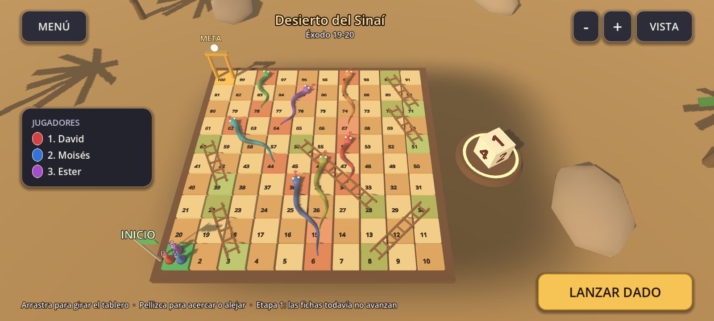
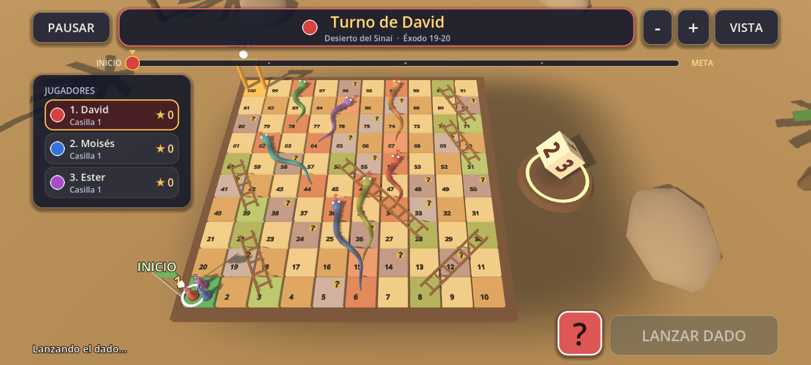
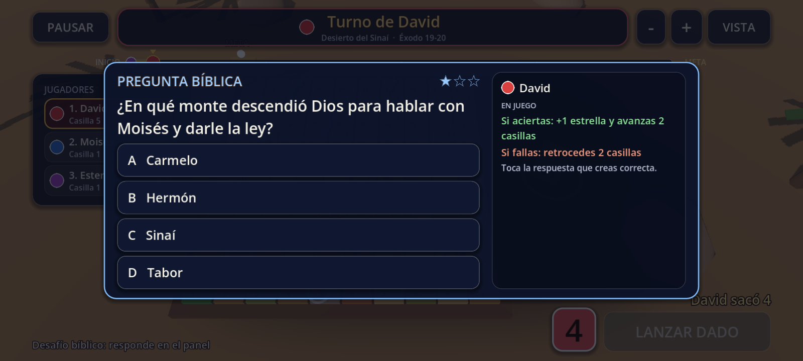
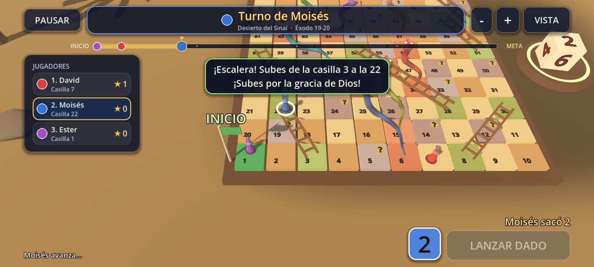
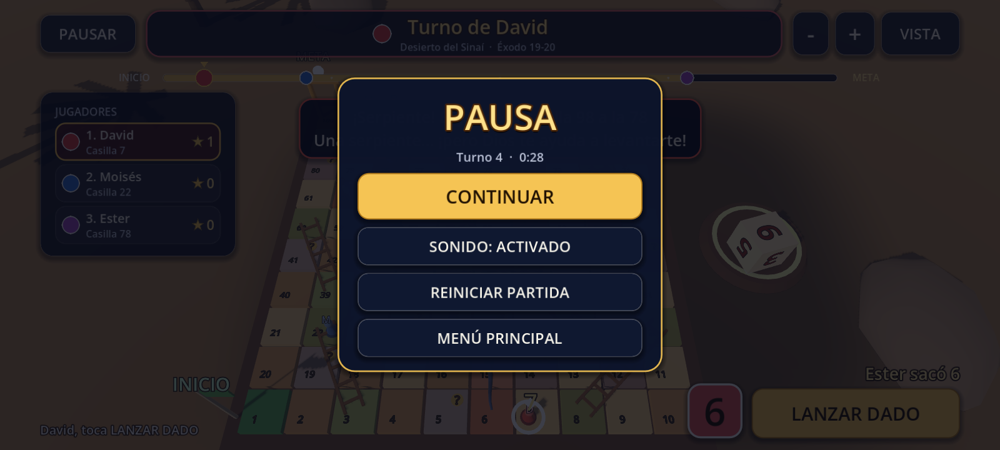
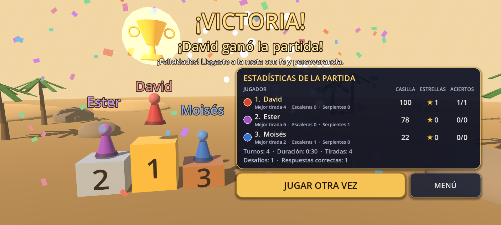
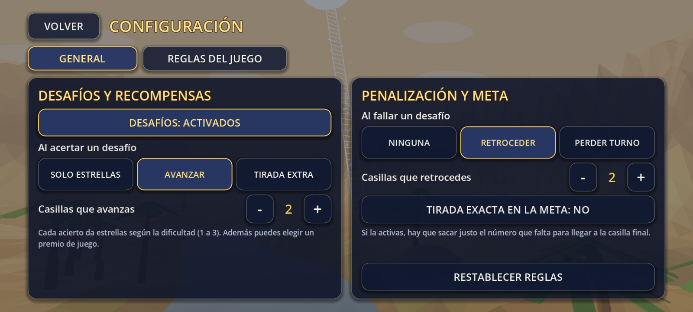
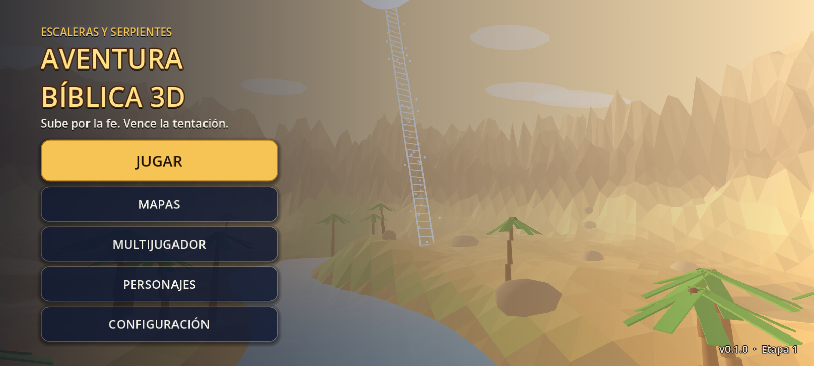

# AVENTURA BÍBLICA 3D

Juego de tablero 3D para Android con temática bíblica (escaleras y serpientes con desafíos), hecho con **Godot 4.7** y **GDScript**.
Orientación horizontal, interfaz táctil y recursos provisionales creados por código, sin modelos externos.

> **Etapa 2 (versión 0.2.0, esta versión):** la mecánica real del juego: turnos de 1 a 4 jugadores, dado 3D, movimiento de fichas,
> escaleras y serpientes animadas, desafíos bíblicos de 5 tipos, premios y castigos configurables, victoria con podio 3D y estadísticas.
> Se verificó con pruebas automáticas en GitHub Actions; **todavía no se probó en un teléfono real** (ver [Qué falta](#qué-falta)).

## Capturas

Generadas automáticamente por GitHub Actions con render por software (en un teléfono se verá más fluido y con otra resolución).

| Tablero y turno actual | Dado 3D |
| --- | --- |
|  |  |
| **Desafío bíblico** | **Escalera** |
|  |  |
| **Pausa** | **Victoria** |
|  |  |
| **Reglas del juego** | **Menú principal** |
|  |  |

## Cómo se juega

1. En **JUGAR** (o en **MULTIJUGADOR**) se elige de 1 a 4 jugadores en el mismo dispositivo; cada uno tiene su propia ficha y su personaje.
2. Cada turno el jugador pulsa **LANZAR DADO**. Mientras el dado rueda, el botón queda bloqueado, y nadie puede tirar fuera de su turno.
3. La ficha avanza casilla por casilla el número que salió, sin pasarse del tablero. Si hace falta, la regla opcional de **tirada exacta** exige sacar justo lo que falta para la casilla 100.
4. Si cae en la base de una **escalera**, sube hasta su extremo superior; si cae en la cabeza de una **serpiente**, baja por su cuerpo hasta la cola.
5. Las casillas con un círculo dorado y un **"?"** son **desafíos bíblicos**: aparece una pregunta con su respuesta correcta, una explicación y una referencia bíblica.
6. Acertar da **estrellas** (1 a 3 según la dificultad) y un premio de juego; fallar aplica la penalización elegida. Siempre hay mensajes de ánimo.
7. Gana el primero que llega a la casilla 100: se abre la pantalla de victoria con podio 3D, confeti y fuegos artificiales, el nombre del ganador y las estadísticas de la partida. Desde ahí se puede **jugar otra vez** o volver al menú.

Controles del tablero: un dedo arrastra para girar la cámara, el pellizco acerca o aleja (también hay botones **+** y **−**) y **VISTA** restaura la cámara.
**PAUSAR** abre el menú de pausa (reanudar, reiniciar la partida con doble toque de confirmación, activar o silenciar el sonido, o volver al menú principal).
En Android, el botón o gesto de atrás pausa la partida durante el juego y, en el menú principal, cierra el juego.

## Qué incluye la Etapa 2

| Parte | Qué hace |
| --- | --- |
| **Turnos (1 a 4 jugadores)** | Director de partida (`GameFlow`) y estado puro de la partida (`MatchState`). Muestra de quién es el turno (cabecera, aviso "TURNO DE …", fila resaltada y aro de luz en la ficha), alterna solo y respeta los turnos extra y los turnos perdidos. |
| **Dado 3D** | Dado animado por código: sube al aire, gira y rebota hasta quedar con la cara elegida arriba; resultado aleatorio del 1 al 6 que se ve en el dado y en pantalla. Bloquea nuevos lanzamientos hasta terminar. |
| **Movimiento** | Saltos suaves casilla por casilla, número de casilla sobre la ficha y en la lista de jugadores, y fichas que se reparten dentro de una casilla compartida. Nunca sale del tablero. |
| **Escaleras y serpientes** | Las 6 escaleras y las 7 serpientes del mapa: la ficha sube peldaño a peldaño por la escalera y baja deslizándose por el cuerpo de la serpiente, con efectos, sonido y mensajes. |
| **Desafíos bíblicos** | 111 desafíos originales en 5 tipos (pregunta de 4 opciones, verdadero o falso, adivinar el personaje, completar el versículo con palabras e identificar el acontecimiento). Cada uno muestra la pregunta, las opciones, la respuesta correcta, la explicación y la referencia. El tablero del Sinaí tiene 20 casillas de desafío y un mazo que no repite preguntas hasta agotar las de cada tipo. |
| **Premios y castigos** | Al acertar: estrellas y, a elección, avanzar casillas o tirar otra vez. Al fallar: nada, retroceder casillas o perder el siguiente turno. Todo se configura en **CONFIGURACIÓN → REGLAS DEL JUEGO** (también activar o desactivar los desafíos y la tirada exacta). |
| **Victoria** | Pantalla 3D con podio, copa dorada, confeti y fuegos artificiales; nombre del ganador; tabla de posición, estrellas y aciertos por jugador; turnos, duración, tiradas y desafíos; botones **JUGAR OTRA VEZ** y **MENÚ**. |
| **Interfaz** | Turno actual, número del dado, posición y estrellas de cada jugador, botón **LANZAR DADO**, panel de preguntas, indicador de progreso hacia la meta con la posición de todos y botón **PAUSAR**. |

Lo de la Etapa 1 se conserva: menú principal 3D, **MAPAS** (solo *Desierto del Sinaí* está disponible; los demás figuran como "PRÓXIMAMENTE"), **MULTIJUGADOR** local, **PERSONAJES** con vista 3D giratoria y **CONFIGURACIÓN** de volumen, calidad gráfica y FPS.

### Reglas configurables

| Opción | Valores | Por defecto |
| --- | --- | --- |
| Desafíos | activados o desactivados | activados |
| Al acertar | solo estrellas · avanzar · tirada extra | avanzar |
| Casillas que avanzas | 1 a 4 | 2 |
| Al fallar | ninguna · retroceder · perder turno | retroceder |
| Casillas que retrocedes | 1 a 4 | 2 |
| Tirada exacta en la meta | sí o no | no |

Con un solo jugador, "perder turno" no tiene efecto (siempre le toca a él).

## Desafíos bíblicos y derechos de autor

* Las preguntas, explicaciones y mensajes de ánimo son **originales**; cada desafío trae una **referencia bíblica** (libro, capítulo y versículo) para poder comprobarla en la Biblia.
* **No se incluye texto de ninguna versión con derechos de autor.** Los desafíos de "completar el versículo" son ideas redactadas con palabras propias, no citas textuales (así consta en `data/questions/challenges.json`).
* La estructura para **RVR1960** ya está preparada pero **desactivada**: `data/verses/translations.json` describe la versión, `data/verses/verse_references.json` guarda solo las referencias y `scripts/questions/verse_provider.gd` entrega texto únicamente de versiones autorizadas. Para activarla, cuando se cuente con la autorización por escrito de las Sociedades Bíblicas Unidas, se crea `data/verses/rvr1960.json` y se marca la versión como autorizada y activa en `translations.json`.

## Estructura

```
aventura-biblica-3d/
├── project.godot            Configuración del proyecto (escena principal, autoloads, Android)
├── export_presets.cfg       Preajuste de exportación a Android (APK de depuración, arm64)
├── icon.svg                 Ícono de la aplicación
├── scenes/
│   ├── menus/               Menú principal y pantallas (mapas, multijugador, personajes, ajustes)
│   ├── boards/              Tablero, dado y pantalla de victoria
│   ├── characters/          Ficha del jugador y vista previa 3D
│   ├── maps/                Entorno 3D de cada mapa
│   ├── interfaces/          Cabecera de pantallas, interfaz del tablero, pausa y victoria
│   └── challenges/          Panel de desafíos bíblicos
├── scripts/
│   ├── game/                Autoloads (SettingsManager, GameState, SceneRouter), director de la partida (game_flow),
│   │                        reglas y estado puros (game_rules, match_state), efectos, mensajes y sonido
│   ├── dice/                Dado 3D
│   ├── players/             Catálogo de personajes, ficha y vista previa
│   ├── questions/           Desafíos: tipos, banco, mazo, referencias bíblicas y proveedor de versículos
│   ├── maps/                Catálogo de mapas, trazado y constructor del tablero, cámara, paisajes y props
│   └── ui/                  Tema visual y controladores de pantallas (interfaz del tablero, panel de desafíos, pausa, victoria)
├── assets/                  models/ textures/ audio/ fonts/ (vacías: todo es provisional por código)
├── data/
│   ├── maps/maps.json                  Definición de mapas, escaleras, serpientes y casillas de desafío
│   ├── questions/challenges.json       Los 111 desafíos bíblicos
│   ├── messages/messages.json          Mensajes de ánimo por situación
│   └── verses/                         Referencias bíblicas (solo citas) y versiones previstas (RVR1960 desactivada)
├── tools/                   Pruebas automáticas (prueba de humo y capturas)
└── .github/                 Compilación y verificación automática en GitHub Actions
```

### Autoloads

* `SettingsManager`: volúmenes, calidad gráfica, FPS y reglas del juego; guarda en `user://settings.cfg`.
* `GameState`: mapa, personaje y número de jugadores elegidos y último resumen de partida; guarda en `user://profile.cfg`.
* `SceneRouter`: navegación entre pantallas con transición, rutas centralizadas y botón de atrás de Android.

## Cómo ejecutar el proyecto

1. Instala **Godot 4.7.x** (versión estable, edición estándar, no .NET): <https://godotengine.org/download>.
2. Abre Godot, pulsa **Importar** y elige el archivo `project.godot` de este repositorio.
3. Espera a que termine la primera importación y pulsa **F5** (Ejecutar proyecto).

El proyecto usa el renderizador **Compatibilidad** (OpenGL), pensado para funcionar bien en móviles de gama media.

## Cómo probarlo en Android

### Opción A: APK generado automáticamente (no necesita computadora)

1. En GitHub abre **Releases** (a la derecha de la página principal del repositorio). Hay dos pre-lanzamientos: **Versión de prueba 0.2.0** (enlace fijo a esa versión) y **latest-debug** (siempre la última subida a `main`).
2. Descarga el archivo `.apk` de la sección *Assets* directamente en el teléfono.
3. Ábrelo y permite la instalación de apps desconocidas cuando Android lo pida.
4. También puedes bajar el APK desde la pestaña **Actions**, en el artefacto **aventura-biblica-3d-apk-debug** de la última ejecución en verde (llega comprimido en `.zip`).

**Importante al actualizar:** cada compilación de GitHub crea una llave de depuración nueva, así que un APK de prueba **no se puede instalar encima de otro** (Android dice "App no instalada"). Si ya tienes instalada otra versión de prueba, por ejemplo la de la Etapa 1, **desinstálala primero** (se pierden los ajustes guardados). Para poder actualizar sin desinstalar habría que usar una llave de firma fija guardada como secreto de GitHub; hoy no está configurada.

### Opción B: exportar desde el editor de Godot

1. En Godot: **Editor → Administrar plantillas de exportación** y descarga las de 4.7.x.
2. En **Editor → Configuración del editor → Exportar → Android** indica el SDK de Android y el JDK 17.
3. En **Proyecto → Exportar** elige el preajuste **Android** y pulsa **Exportar proyecto** (o conecta el teléfono con depuración USB y usa **Despliegue con un clic**).

El preajuste ya trae: paquete `com.aventurabiblica.game3d`, arquitectura arm64-v8a, sin Gradle, pantalla horizontal, modo inmersivo y sin permisos extra.

## Verificación automática

El flujo `.github/workflows/build.yml` ejecuta en cada subida de código, con Godot real:

1. **validar**: importa el proyecto, compila los scripts y ejecuta `tools/smoke_test.gd`, que además de cargar todas las escenas, rutas, datos y pantallas **juega de verdad** sobre el tablero real:
   * turnos y bloqueo del dado (de 1 a 4 jugadores) y orden de turnos durante partidas completas;
   * movimiento ficha por ficha, sin salirse del tablero;
   * las **6 escaleras y las 7 serpientes** en la partida real, con la ficha siguiendo el camino y los contadores de estadísticas;
   * los **5 tipos de desafío**, acertando y fallando, con sus explicaciones y referencias;
   * premios y castigos (estrellas, avanzar, tirada extra, retroceder, perder turno), con los desafíos desactivados y con la tirada exacta;
   * pausa (botón, tecla Escape y botón atrás de Android), victoria, estadísticas, **jugar otra vez** y una partida completa de 4 jugadores jugada de principio a fin por un robot.
2. **capturas**: abre cada pantalla con una pantalla virtual y guarda imágenes.
3. **android**: exporta el APK de depuración con las plantillas oficiales, revisa su contenido y su firma con `aapt2` y `apksigner`, y además arranca el juego solo desde el paquete de datos exportado para comprobar que todo lo necesario viaja dentro. Al subir a `main` publica los pre-lanzamientos con el APK.
4. **resumen**: deja los registros y las imágenes en la rama `ci-artifacts`.

El resultado de cada ejecución (verde o rojo) se ve en la pestaña **Actions**. Un APK solo existe si el paso de exportación terminó bien. Estas pruebas **no sustituyen probar el juego en un teléfono real**: el rendimiento, el sonido y el comportamiento táctil en un dispositivo concreto solo se conocen probándolo ahí.

## Datos y cómo ampliar

* **Nuevos desafíos:** añade objetos a `data/questions/challenges.json` con el mismo formato (`id`, `type`, `difficulty` de 1 a 3, `prompt`, `options`, `correct`, `explanation`, `reference`; los de personaje llevan además `clues`). Usa referencias verificables y redacta con tus propias palabras: no copies texto de versiones con derechos de autor.
* **Nuevo mapa:** añade una entrada en `data/maps/maps.json` (tamaño del tablero, escaleras, serpientes, casillas de desafío, colores y props) y cambia su `status` a `"available"` cuando esté listo. El tablero se construye a partir de esos datos.
* **Mensajes de ánimo:** edita `data/messages/messages.json` (hay varias frases por situación).
* **Modelos reales:** coloca los archivos en `assets/models/` y sustituye el recurso provisional correspondiente (fichas en `scenes/characters/`, props en `scripts/maps/prop_factory.gd`).

## Qué falta

* **Probar en un teléfono real:** hasta ahora solo hay verificación automática (render por software en GitHub). Falta medir fluidez, sonido y comportamiento táctil en un dispositivo.
* Texto bíblico completo (RVR1960) en los desafíos de completar versículos: la estructura está lista y desactivada hasta tener autorización.
* Mapas bíblicos adicionales con sus modelos, texturas y paisajes propios (hoy solo está *Desierto del Sinaí*).
* Multijugador en línea (la estructura de jugadores ya admite varios; falta la red).
* Música ambiental, sonidos definitivos y modelos 3D definitivos (hoy todo es provisional, creado por código).
* Exportación firmada para Google Play (hoy solo hay APK de depuración).

## Licencia

Aún sin definir. Hasta que se indique otra cosa, todos los derechos están reservados por el autor del repositorio.
