# EL CAMINO DE LA VIDA (antes AVENTURA BÍBLICA 3D)

> **En transformación:** el proyecto se está convirtiendo en **EL CAMINO DE LA VIDA**, un juego de tablero 3D cristiano con ruleta, caminos
> que se bifurcan, decisiones, monedas y desafíos bíblicos. Va por etapas ([plan](docs/camino/PLAN.md)); hoy está hecha la **etapa 1 (base)**:
> el modo nuevo aparece en el menú principal pero todavía no se puede jugar. **AVENTURA BÍBLICA** (escaleras y serpientes) se conserva
> completo como modo del menú, y lo que sigue en este documento describe ese modo.

Juego de tablero 3D para Android con temática bíblica (escaleras y serpientes con desafíos), hecho con **Godot 4.7** y **GDScript**.
Orientación horizontal, interfaz táctil y recursos provisionales creados por código, sin modelos externos.

> **Etapa 4, fase 4.1 (versión 0.4.0-alfa.1, esta versión):** la **base del juego en línea**: un servidor en Cloudflare (listo para publicar con tu cuenta,
> ver [`docs/online/CONFIGURAR_SERVIDOR.md`](docs/online/CONFIGURAR_SERVIDOR.md)), la conexión segura del juego con ese servidor y el panel **PARTIDA EN LÍNEA**
> de MULTIJUGADOR. **Todavía no se puede jugar una partida en línea:** las salas, los códigos de invitación y los turnos sincronizados son las fases 4.2 y 4.3.
> Se verificó con pruebas automáticas en GitHub Actions; **esta versión todavía no se probó en un teléfono real** (según informó el autor, la 0.3.0 funciona
> bien en su Moto G84 5G). Ver [Qué falta](#qué-falta).
>
> **Etapa 3 (versión 0.3.0):** el **MUNDO BÍBLICO** (un mapa 3D con 7 regiones conectadas) y **7 mundos jugables**, cada uno con su
> paisaje, su tablero propio de 100 casillas, su sonido ambiental, desafíos propios, desbloqueo progresivo, insignias y progreso guardado.

## Capturas

Generadas automáticamente por GitHub Actions con render por software (en un teléfono se verá más fluido y con otra resolución). Las de cada mundo muestran
la **entrada del tablero**: la cámara empieza baja y con ángulo ancho para enseñar el paisaje y luego sube sola a la vista de juego.

| MUNDO BÍBLICO (vista general) | Región elegida: su ficha y JUGAR |
| --- | --- |
| 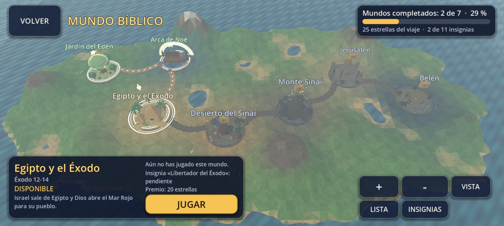 | 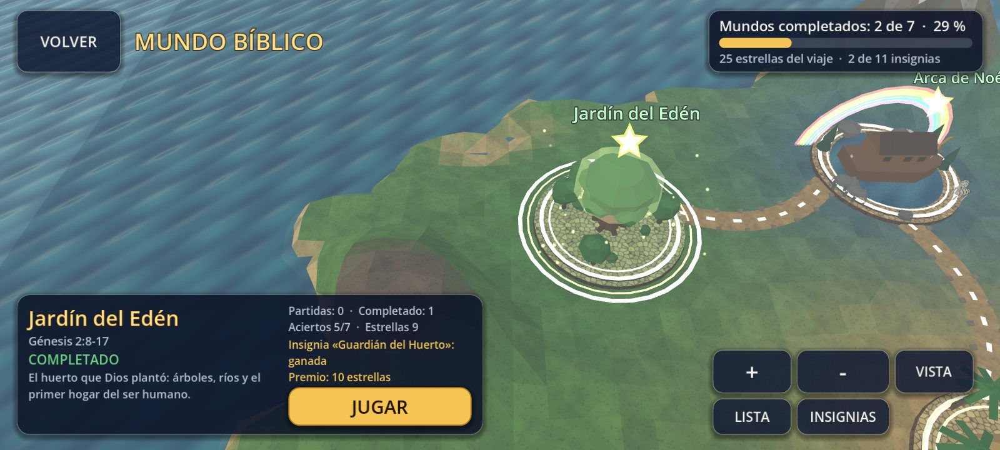 |
| **Insignias** | **Mundo nuevo abierto** |
| 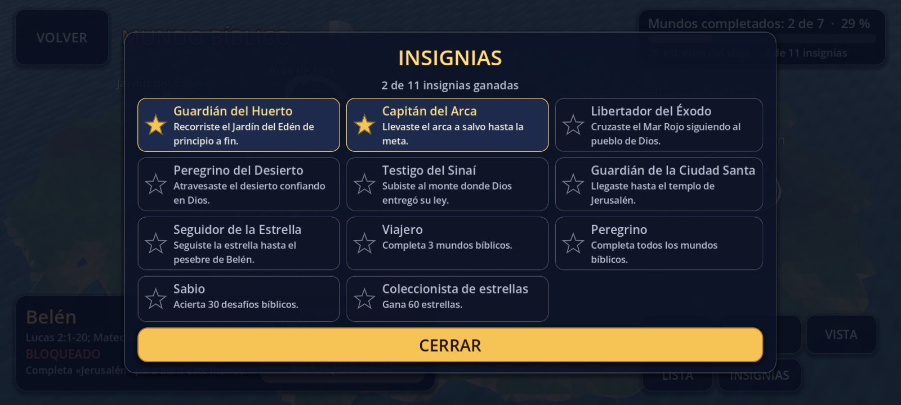 | 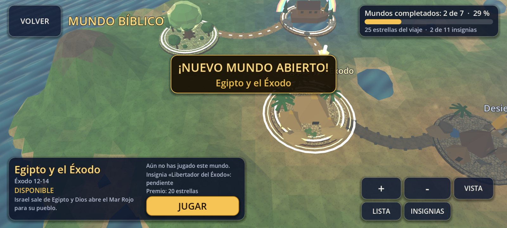 |

| Jardín del Edén | Arca de Noé |
| --- | --- |
| 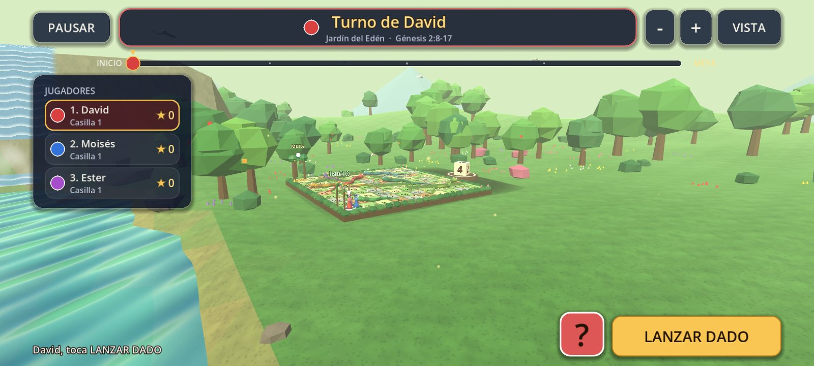 | 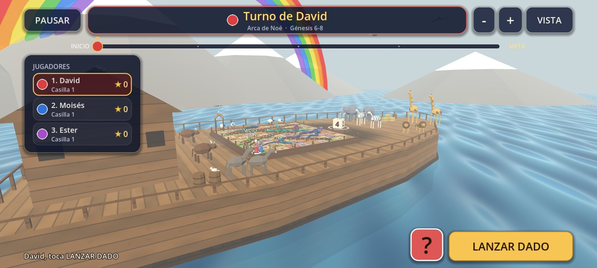 |
| **Egipto y el Éxodo** | **Desierto del Sinaí** |
| 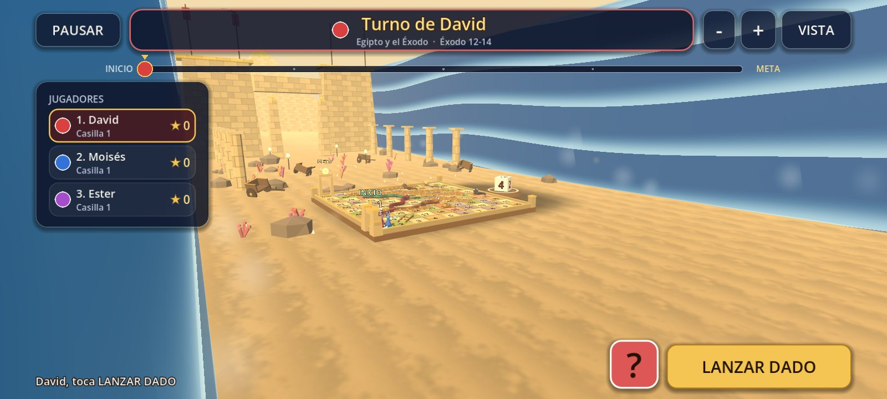 | 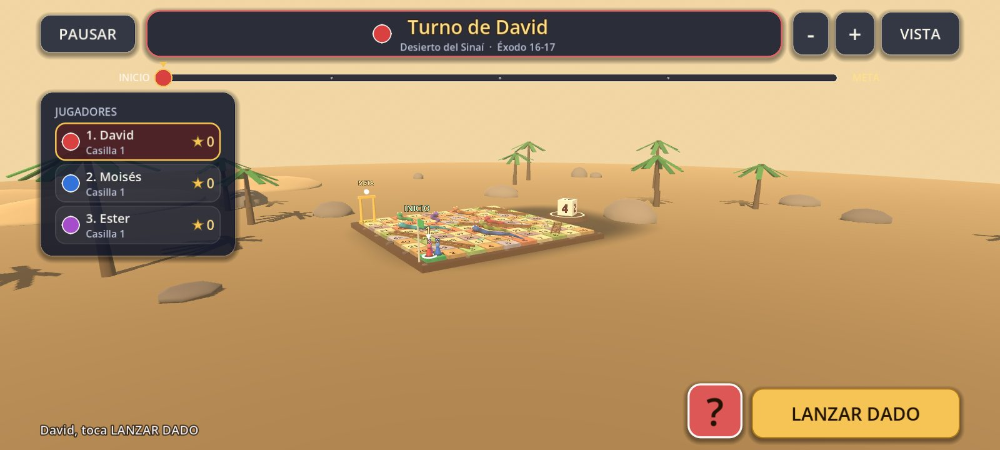 |
| **Monte Sinaí** | **Jerusalén** |
| 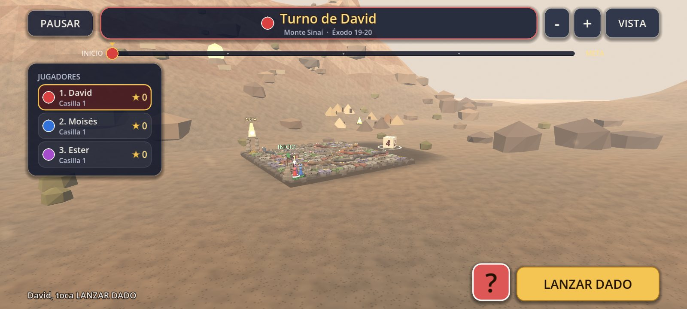 | 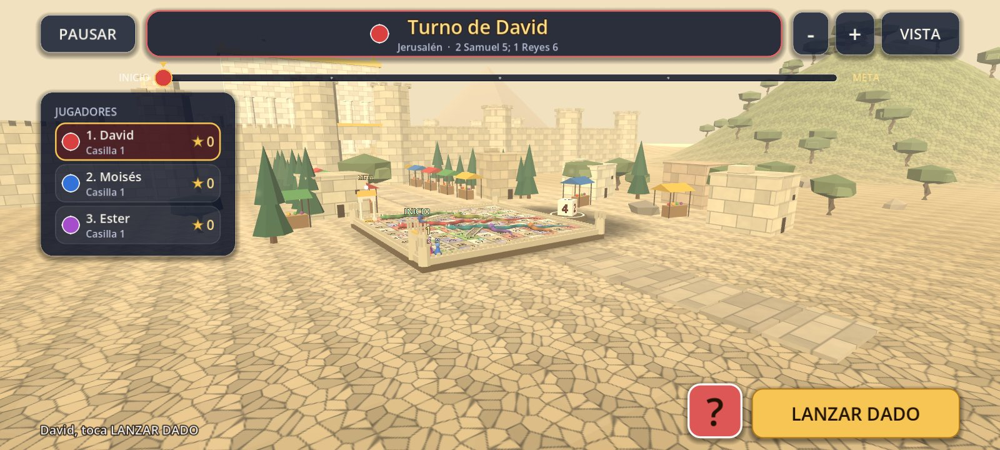 |
| **Belén** | **Tablero en la vista de juego** |
| 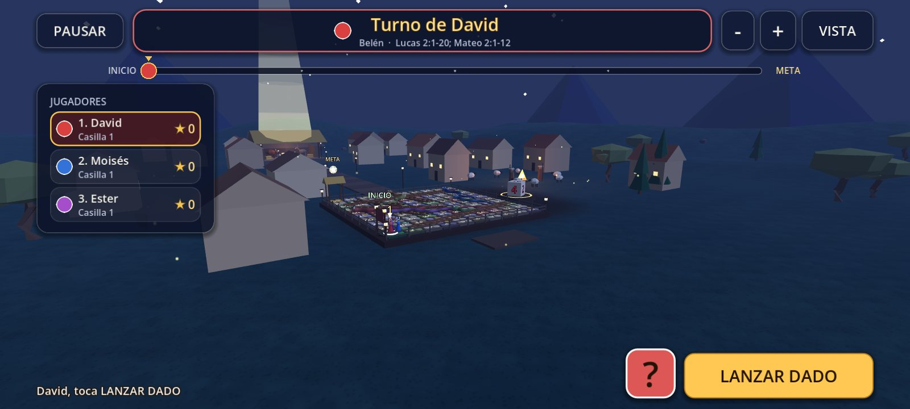 | 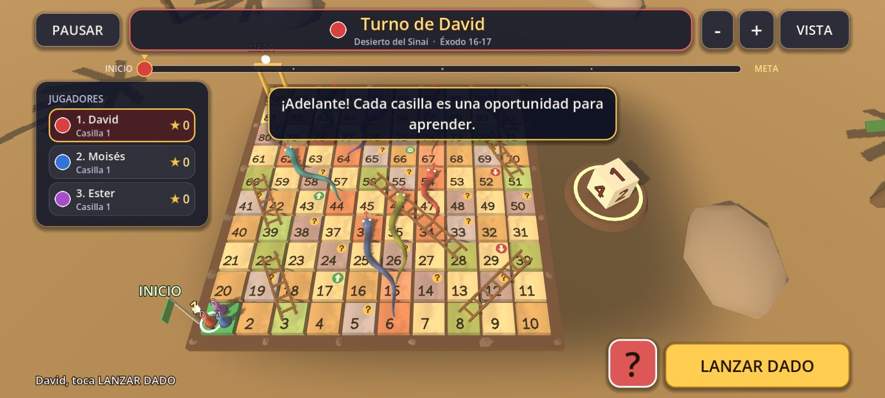 |

| Desafío bíblico | Victoria y premios del mundo |
| --- | --- |
| 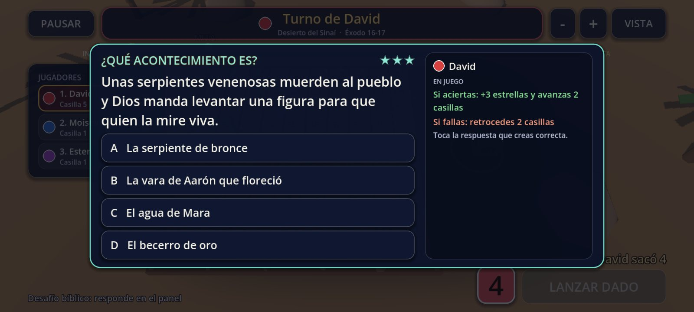 | 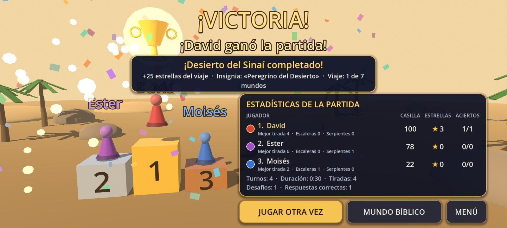 |

| MULTIJUGADOR con el panel PARTIDA EN LÍNEA (Etapa 4; aquí el servidor todavía no está configurado) |
| --- |
| 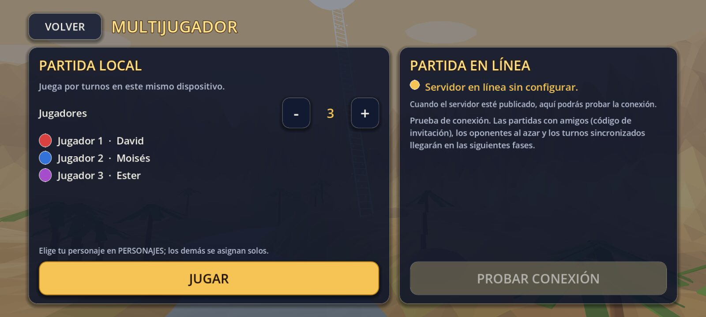 |

## Cómo se juega

1. En el menú principal, **MAPAS** abre el **MUNDO BÍBLICO**. Toca un mundo para elegirlo (la cámara vuela hasta él y se abre su ficha con la referencia bíblica, tus estadísticas y su insignia). Un segundo toque, o el botón **JUGAR** de la ficha, abre su tablero. Los mundos con candado explican qué mundo hay que completar antes. El botón **JUGAR** del menú principal abre directamente el último mundo elegido (al empezar, el Jardín del Edén).
2. Se elige de 1 a 4 jugadores en el mismo dispositivo (**MULTIJUGADOR**); cada uno tiene su propia ficha y su personaje. El panel **PARTIDA EN LÍNEA** de esa misma pantalla, por ahora, solo prueba la conexión con el servidor (ver [Qué incluye la Etapa 4](#qué-incluye-la-etapa-4-fase-41-base-en-línea)).
3. Cada turno el jugador pulsa **LANZAR DADO**. Mientras el dado rueda, el botón queda bloqueado, y nadie puede tirar fuera de su turno.
4. La ficha avanza casilla por casilla el número que salió. Si cae en la base de una **escalera**, sube; si cae en la cabeza de una **serpiente**, baja por su cuerpo.
5. Las casillas con un círculo dorado y un **"?"** son **desafíos bíblicos**: una pregunta con su respuesta, su explicación y su referencia. Acertar da **estrellas** y un premio de juego; fallar aplica la penalización elegida.
6. Cada mundo tiene además **4 casillas de premio** (avanzar, tirar otra vez o ganar estrellas) y **4 obstáculos** (retroceder o perder el turno), con nombres y citas de su propia historia.
7. Gana el primero que llega a la casilla 100: podio 3D, estadísticas de la partida y, si es la primera vez que se completa ese mundo, **premio en estrellas, insignia y el siguiente mundo abierto**. De vuelta en el mapa, una animación abre el candado.

**Controles del mapa mundial:** un dedo arrastra, el pellizco acerca o aleja (también hay botones **+** y **−**), **VISTA** vuelve a la vista general, **LISTA** muestra la lista de mapas e **INSIGNIAS** abre la colección.
**Controles del tablero:** al entrar, la cámara empieza baja y con ángulo ancho para mostrar el paisaje del mundo y sube sola hasta la vista de juego. Un dedo gira la cámara (se puede bajar hasta casi el horizonte para ver montañas y cielo), el pellizco acerca o aleja, **VISTA** la restaura y **PAUSAR** abre el menú de pausa. En Android, el botón o gesto de atrás pausa la partida, cierra las insignias y vuelve de la lista al mapa.

## Qué incluye la Etapa 4 (fase 4.1: base en línea)

| Parte | Qué hace |
| --- | --- |
| **Servidor** (`server/`) | Cloudflare Workers + un Durable Object (`Hub`) con conexiones WebSocket que "duermen" cuando no hay actividad. Saluda, mantiene el latido, cuenta los jugadores en línea y reanuda sesiones. La lógica pura (`hub_core.js`) está separada del pegamento con Cloudflare (`worker.js`) para poder probarla sin red. Ver [`server/README.md`](server/README.md). |
| **Cliente** (`scripts/online/`) | `OnlineManager` (autoload), `OnlineClient` (estados, reintentos con espera creciente, latido), `OnlineProtocol`, `OnlineConfig` y el transporte `WebSocketTransport`, sobre el `WebSocketPeer` de Godot. |
| **Identidad anónima** | Un identificador al azar por dispositivo (`user://online.cfg`) y una sesión que entrega el servidor. Sin cuentas, correos ni contraseñas. |
| **Pantalla** | El panel **PARTIDA EN LÍNEA** de **MULTIJUGADOR** muestra el estado (*Conectando…*, *Conectado · N jugadores en línea*, *Reintentando…*, errores explicados) y el botón **PROBAR CONEXIÓN**. La conexión solo existe mientras esa pantalla está abierta. |
| **Seguridad** | Solo `wss://`; sin secretos en el APK (únicamente la dirección pública del servidor, en `data/online.json`); límites de tamaño, ritmo y conexiones en el servidor; las claves de Cloudflare solo viven como secretos de GitHub. |
| **Android** | Permiso `INTERNET` y llave de depuración guardada (se crea una vez en GitHub): los APK siguientes deberían instalarse **encima** del anterior. |

**Cómo activar el servidor (desde el teléfono):** crea una cuenta gratuita de Cloudflare, guarda dos secretos en GitHub y pulsa **Run workflow** en *Desplegar servidor en línea*. El flujo publica el servidor, lo prueba, guarda su dirección en `data/online.json` y recompila la app. Pasos detallados en [`docs/online/CONFIGURAR_SERVIDOR.md`](docs/online/CONFIGURAR_SERVIDOR.md); el diseño completo, en [`docs/online/ARQUITECTURA.md`](docs/online/ARQUITECTURA.md).

**Plan de la Etapa 4:** 4.1 base en línea *(esta versión)* → 4.2 salas privadas y públicas → 4.3 turnos sincronizados → 4.4 personajes 3D → 4.5 animaciones y recompensas → 4.6 música y sonidos → 4.7 perfiles y estadísticas → 4.8 pruebas, optimización y APK final. Cada fase se informa antes de empezar la siguiente.

## Qué incluye la Etapa 3

| Parte | Qué hace |
| --- | --- |
| **MUNDO BÍBLICO** | Mapa 3D gigante (`world_map_builder.gd`) con isla, relieve, mar, 7 regiones y 6 caminos que las unen. Cámara con zoom y movimiento táctil (`world_camera.gd`), iconos 3D propios, aro y salto al elegir una región, candados, aros de luz, estrella de completado y flecha dorada sobre el próximo mundo. |
| **7 mundos con identidad propia** | Cada mundo tiene su paisaje 3D, su luz y su niebla, vegetación y decorado propios, efectos (agua, nubes, luciérnagas, fogata, estrella) y su **tablero**: otra forma de casilla, de borde y de números (ver la tabla de abajo). No es el mismo tablero con otros colores. |
| **Progresión** | El Edén está abierto desde el principio; cada mundo se abre al completar el anterior. Se guardan mundos abiertos y completados, estadísticas por región (partidas, completados, aciertos, estrellas), **11 insignias** (7 de mundo y 4 generales) y el viaje total. Indicador de avance (*Mundos completados: 2 de 7 · 29 %*). |
| **Recompensas** | Cada mundo da estrellas al completarse por primera vez (10, 15, 20, 25, 30, 35 y 50) y una insignia con su nombre. |
| **Tableros y motor compartido** | Los 7 tableros tienen 100 casillas, inicio, meta, 6 escaleras, 7 serpientes, 20 desafíos, 4 premios y 4 obstáculos. Todos se arman con el mismo motor (`BoardBuilder`, `BoardLayout`, `GameFlow`, `MatchState`) a partir de `data/maps/maps.json`: no hay código repetido por mapa. |
| **Sonidos ambientales** | Siete bucles originales de 5 segundos generados por código (`ambience_synth.gd`), que cierran sin saltos y suenan por el bus de música. El mapa mundial tiene oleaje de fondo. |
| **Desafíos y Biblia** | 251 desafíos originales con referencia bíblica verificable: 111 generales y 20 propios de cada mundo. Estructura de RVR1960 preparada pero desactivada. |
| **Optimización Android** | Sin sombras en el mapa mundial, un solo terreno en caché, mallas combinadas, texturas pequeñas generadas por código, tres niveles de calidad y presupuestos de triángulos comprobados por pruebas. |

Lo de las etapas anteriores se conserva: menú principal 3D, **MULTIJUGADOR** local, **PERSONAJES**, **CONFIGURACIÓN**, turnos, dado 3D, escaleras y serpientes animadas, desafíos, premios y castigos y victoria con podio.

### Los 7 mundos

| # | Mundo | Referencia | Tablero | Se abre al completar | Premio | Insignia | Sonido |
| --- | --- | --- | --- | --- | --- | --- | --- |
| 1 | **Jardín del Edén** | Génesis 2:8-17 | losas de piedra con musgo y flores, seto alrededor | (abierto) | 10 ★ | Guardián del Huerto | arroyo y pájaros |
| 2 | **Arca de Noé** | Génesis 6-8 | cubierta de tablones con ranuras y borda de barco | Jardín del Edén | 15 ★ | Capitán del Arca | oleaje y gaviotas |
| 3 | **Egipto y el Éxodo** | Éxodo 12-14 | bloques de arenisca con friso dorado y muro bajo | Arca de Noé | 20 ★ | Libertador del Éxodo | viento del desierto |
| 4 | **Desierto del Sinaí** | Éxodo 16-17 | losas de arena con piedras en las esquinas | Egipto y el Éxodo | 25 ★ | Peregrino del Desierto | viento seco y halcón |
| 5 | **Monte Sinaí** | Éxodo 19-20 | lajas irregulares de roca y bloques alrededor | Desierto del Sinaí | 30 ★ | Testigo del Sinaí | acordes celestiales y trueno |
| 6 | **Jerusalén** | 2 Samuel 5; 1 Reyes 6 | adoquines en cuatro piezas y muralla con almenas | Monte Sinaí | 35 ★ | Guardián de la Ciudad Santa | murmullo, campanas y shofar |
| 7 | **Belén** | Lucas 2:1-20; Mateo 2:1-12 | tierra con piedras redondas y cerca de madera con faroles (de noche) | Jerusalén | 50 ★ | Seguidor de la Estrella | grillos y campanitas |

Insignias generales: **Viajero** (completar 3 mundos), **Peregrino** (completar todos), **Sabio** (acertar 30 desafíos) y **Coleccionista de estrellas** (ganar 60 estrellas).

### Rendimiento en Android

El objetivo es un **Motorola Moto G84 5G**. Estas cifras salen de las pruebas automáticas (tope de cada prueba entre paréntesis); la fluidez real hay que medirla en el teléfono.

| Parte | Triángulos | Mallas (órdenes de dibujo) |
| --- | --- | --- |
| Mapa mundial (calidad media) | 46 625 (tope de la prueba: 110 mil) | 94 (tope: 170) |
| Paisaje de un mundo | de 10 316 (Arca de Noé) a 27 775 (Jerusalén); tope 90 mil | de 17 a 31 |
| Tablero de 100 casillas | de 9 010 (Desierto del Sinaí) a 18 389 (Belén) | de 30 a 33 |
| Escena completa de un tablero (paisaje + tablero + fichas) | de 11 548 (Desierto del Sinaí) a 43 417 (Jerusalén); tope de la prueba: 120 mil | de 63 (Belén) a 195 (Desierto del Sinaí, cuyo paisaje es el de la Etapa 2); tope: 300 |

* El mapa mundial no usa sombras; el terreno se calcula una sola vez por sesión y se reutiliza.
* La calidad **baja** quita decorado, luces dinámicas y sombras; en cada paisaje las pruebas comprueban que usa menos triángulos que la alta.
* Los sonidos ambientales se generan mientras la pantalla de transición sigue en negro (en el equipo de pruebas tardan entre 50 y 100 ms cada uno) y quedan guardados en memoria.
* El juego limita los cuadros por segundo a 60 (ajustable en **CONFIGURACIÓN**). Las pruebas comprueban los gestos del mapa con eventos táctiles reales, pero no sustituyen medir la fluidez en el teléfono.

## Qué incluyó la Etapa 2

| Parte | Qué hace |
| --- | --- |
| **Turnos (1 a 4 jugadores)** | Director de partida (`GameFlow`) y estado puro de la partida (`MatchState`). Muestra de quién es el turno, alterna solo y respeta los turnos extra y los turnos perdidos. |
| **Dado 3D** | Dado animado por código: sube al aire, gira y rebota hasta quedar con la cara elegida arriba. Bloquea nuevos lanzamientos hasta terminar. |
| **Movimiento** | Saltos suaves casilla por casilla, número de casilla sobre la ficha y fichas que se reparten dentro de una casilla compartida. |
| **Escaleras y serpientes** | La ficha sube peldaño a peldaño por la escalera y baja deslizándose por el cuerpo de la serpiente, con efectos, sonido y mensajes. |
| **Desafíos bíblicos** | 5 tipos (pregunta de 4 opciones, verdadero o falso, adivinar el personaje, completar el versículo con palabras e identificar el acontecimiento) con explicación y referencia. El mazo no repite preguntas hasta agotar las de cada tipo. |
| **Premios y castigos** | Al acertar: estrellas y, a elección, avanzar casillas o tirar otra vez. Al fallar: nada, retroceder casillas o perder el siguiente turno. Se configura en **CONFIGURACIÓN → REGLAS DEL JUEGO**. |
| **Victoria** | Pantalla 3D con podio, copa, confeti y fuegos artificiales; ganador, posiciones, estrellas, aciertos, turnos y duración; **JUGAR OTRA VEZ** y **MENÚ**. |

### Reglas configurables

| Opción | Valores | Por defecto |
| --- | --- | --- |
| Desafíos | activados o desactivados | activados |
| Al acertar | solo estrellas · avanzar · tirada extra | avanzar |
| Casillas que avanzas | 1 a 4 | 2 |
| Al fallar | ninguna · retroceder · perder turno | retroceder |
| Casillas que retrocedes | 1 a 4 | 2 |
| Tirada exacta en la meta | sí o no | no |

Con un solo jugador, "perder turno" no tiene efecto (siempre le toca a él).

## Desafíos bíblicos y derechos de autor

* Hay **251 desafíos**: 111 generales y **20 propios de cada mundo** (preguntas sobre su historia). Las preguntas, explicaciones y mensajes de ánimo son **originales**; cada desafío trae una **referencia bíblica** (libro, capítulo y versículo) para poder comprobarla en la Biblia.
* **No se incluye texto de ninguna versión con derechos de autor.** Los desafíos de "completar el versículo" son ideas redactadas con palabras propias, no citas textuales (así consta en `data/questions/challenges.json`).
* La estructura para **RVR1960** ya está preparada pero **desactivada**: `data/verses/translations.json` describe la versión, `data/verses/verse_references.json` guarda solo las referencias y `scripts/questions/verse_provider.gd` entrega texto únicamente de versiones autorizadas. Para activarla, cuando se cuente con la autorización por escrito de las Sociedades Bíblicas Unidas, se crea `data/verses/rvr1960.json` y se marca la versión como autorizada y activa en `translations.json`.

## Estructura

```
aventura-biblica-3d/
├── project.godot            Configuración del proyecto (escena principal, autoloads, Android)
├── export_presets.cfg       Preajuste de exportación a Android (APK de depuración, arm64)
├── icon.svg                 Ícono de la aplicación
├── scenes/
│   ├── menus/               Menú principal, MUNDO BÍBLICO (world_screen), lista de mapas, multijugador, personajes y ajustes
│   ├── boards/              Tablero, dado y pantalla de victoria
│   ├── characters/          Ficha del jugador y vista previa 3D
│   ├── maps/                Entorno 3D de cada mapa
│   ├── interfaces/          Cabecera de pantallas, interfaz del tablero, pausa y victoria
│   └── challenges/          Panel de desafíos bíblicos
├── scripts/
│   ├── game/                Autoloads (SettingsManager, ProgressManager, GameState, SceneRouter), director de la partida (game_flow),
│   │                        reglas y estado puros (game_rules, match_state, progress_data), efectos, mensajes y sonido
│   │                        (audio_synth para efectos, ambience_synth y ambience_player para los ambientes de cada mundo)
│   ├── dice/                Dado 3D
│   ├── online/              Juego en línea (Etapa 4): OnlineManager (autoload), cliente con reintentos, protocolo, configuración y transporte WebSocket
│   ├── players/             Catálogo de personajes, ficha y vista previa
│   ├── questions/           Desafíos: tipos, banco, mazo, referencias bíblicas y proveedor de versículos
│   ├── maps/                Catálogo de mapas, trazado y constructor del tablero, estilos de tablero, cámara, entorno,
│   │   │                    mapa mundial (world_map_builder, world_icons, world_camera) y herramientas de escenarios
│   │   ├── kit/             Mallas, props, animales, terreno, agua, efectos, texturas y números de trazos
│   │   └── scenery/         Un paisaje por mundo (Edén, Arca, Egipto, Sinaí, Jerusalén y Belén)
│   └── ui/                  Tema visual y controladores de pantallas (mundo bíblico, interfaz del tablero, desafíos, pausa, victoria)
├── assets/                  models/ textures/ audio/ fonts/ (casi vacías: todo es provisional, creado por código)
├── data/
│   ├── maps/maps.json                  Los 7 mundos: tablero, escaleras, serpientes, desafíos, premios, obstáculos, luz, sonido,
│   │                                   posición en el mapa mundial, desbloqueo y recompensa
│   ├── questions/challenges.json       Los 251 desafíos bíblicos
│   ├── messages/messages.json          Mensajes de ánimo por situación
│   ├── verses/                         Referencias bíblicas (solo citas) y versiones previstas (RVR1960 desactivada)
│   └── online.json                     Dirección del servidor en línea (vacía hasta publicarlo; la completa el flujo de despliegue)
├── docs/                    Capturas del README, notas de cada versión (docs/release-notes) y documentación del juego en línea (docs/online)
├── server/                  Servidor en línea (Cloudflare Workers): código, pruebas de Node y pruebas de extremo a extremo
├── tools/                   Pruebas automáticas (prueba de humo, capturas y prueba del cliente en línea)
└── .github/                 Compilación y verificación automática, y publicación del servidor, en GitHub Actions
```

### Autoloads

* `SettingsManager`: volúmenes, calidad gráfica, FPS y reglas del juego; guarda en `user://settings.cfg`.
* `ProgressManager`: mundos abiertos y completados, insignias y estadísticas por región; guarda en `user://progress.cfg` cada vez que cambia.
* `GameState`: mapa, personaje y número de jugadores elegidos y último resumen de partida; guarda en `user://profile.cfg`.
* `SceneRouter`: navegación entre pantallas con transición, rutas centralizadas y botón de atrás de Android.
* `OnlineManager`: dirección del servidor (se lee de `data/online.json`), cliente en línea y estado de la conexión para la pantalla MULTIJUGADOR; guarda el identificador anónimo del dispositivo en `user://online.cfg`. La conexión solo está abierta mientras esa pantalla lo está.

## Cómo ejecutar el proyecto

1. Instala **Godot 4.7.x** (versión estable, edición estándar, no .NET): <https://godotengine.org/download>.
2. Abre Godot, pulsa **Importar** y elige el archivo `project.godot` de este repositorio.
3. Espera a que termine la primera importación y pulsa **F5** (Ejecutar proyecto).

El proyecto usa el renderizador **Compatibilidad** (OpenGL), pensado para funcionar bien en móviles de gama media.

## Cómo probarlo en Android

### Opción A: APK generado automáticamente (no necesita computadora)

1. En GitHub abre **Releases** (a la derecha de la página principal del repositorio). Hay pre-lanzamientos: **Versión de prueba 0.4.0-alfa.1** (enlace fijo a esa versión), **latest-debug** (siempre la última subida a `main`) y los de versiones anteriores (v0.3.0, …).
2. Descarga el archivo `.apk` de la sección *Assets* directamente en el teléfono. El de la versión 0.4.0-alfa.1 es `aventura-biblica-3d-v0.4.0-alfa.1-debug.apk`.
3. Ábrelo y permite la instalación de apps desconocidas cuando Android lo pida.
4. También puedes bajar el APK desde la pestaña **Actions**, en el artefacto **aventura-biblica-3d-apk-debug** de la última ejecución en verde (llega comprimido en `.zip`).

**Importante al actualizar:** hasta la 0.3.0, cada compilación de GitHub creaba una llave de depuración nueva, así que esos APK no se podían instalar unos encima de otros (Android dice "App no instalada"). **Desde la 0.4.0-alfa.1 la llave se crea una sola vez y se guarda en la caché de GitHub Actions** (nunca en el repositorio), y todas las compilaciones la reutilizan. Por eso: **desinstala una sola vez la 0.3.0 (o anterior)** antes de instalar la 0.4.0-alfa.1 (se pierden los ajustes y el progreso guardados en ese teléfono). A partir de ahí, Android debería aceptar los APK nuevos encima del anterior; eso todavía no se probó en un teléfono. Si GitHub borrara la caché (lo hace tras 7 días sin uso), la siguiente compilación de `main` crearía otra llave y habría que desinstalar una vez más. Es una llave de depuración: sirve para pruebas, **no** para Google Play. Detalles en [`docs/online/ARQUITECTURA.md`](docs/online/ARQUITECTURA.md#firma-del-apk-de-prueba-actualizar-sin-desinstalar).

### Opción B: exportar desde el editor de Godot

1. En Godot: **Editor → Administrar plantillas de exportación** y descarga las de 4.7.x.
2. En **Editor → Configuración del editor → Exportar → Android** indica el SDK de Android y el JDK 17.
3. En **Proyecto → Exportar** elige el preajuste **Android** y pulsa **Exportar proyecto** (o conecta el teléfono con depuración USB y usa **Despliegue con un clic**).

El preajuste ya trae: paquete `com.aventurabiblica.game3d`, arquitectura arm64-v8a, sin Gradle, pantalla horizontal, modo inmersivo y un solo permiso: Internet (para el juego en línea).

## Verificación automática

El flujo `.github/workflows/build.yml` ejecuta en cada subida de código, con Godot real:

1. **validar**: importa el proyecto, compila todos los scripts y ejecuta `tools/smoke_test.gd`, que carga todas las escenas, rutas y datos, y además **juega de verdad**:
   * **mapa mundial:** relieve, caminos e iconos; cámara con arrastre, pellizco, rueda y toque con eventos táctiles reales; elegir una región, abrir su tablero con doble toque o con **JUGAR**; mundos cerrados que no se abren; celebración y candado que se abre; insignias; **LISTA** y volver;
   * **progreso:** desbloqueo en cadena, premios, insignias, estadísticas por región y **guardado** y carga del archivo;
   * **los 7 mundos:** partidas completas simuladas en los 7 tableros, cada tablero armado en la escena real con sus escaleras, serpientes, desafíos y casillas especiales, su ambiente sonoro, su presupuesto de triángulos y un primer turno jugado con dado y ficha;
   * **sonidos ambientales:** los 7 bucles no están vacíos, no se recortan, cierran sin salto, tienen movimiento y suenan distinto entre sí;
   * **juego en línea (cliente):** el protocolo y sus números coinciden con los de `server/src/protocol.js`, configuración, reintentos con espera creciente, latido, códigos de cierre y la pantalla MULTIJUGADOR con un transporte falso; el proyecto declara el permiso de Internet y excluye `server/` del APK;
   * turnos y bloqueo del dado (de 1 a 4 jugadores), movimiento ficha por ficha, las **6 escaleras y 7 serpientes**, los **5 tipos de desafío**, premios y castigos, pausa (botón, Escape y atrás de Android), victoria, jugar otra vez y una partida completa jugada por un robot.
2. **capturas**: abre cada pantalla (mapa mundial, los 7 mundos, menús y tablero) con una pantalla virtual y guarda imágenes.
3. **android**: exporta el APK de depuración con las plantillas oficiales, revisa su contenido, su permiso de Internet y su firma con `aapt2` y `apksigner`, y arranca el juego solo desde el paquete de datos exportado. Al subir a `main` publica los pre-lanzamientos con el APK.
4. **en_linea**: levanta el servidor con `wrangler dev` (el mismo motor que Cloudflare), pasa las 52 pruebas de Node del servidor, ejecuta 17 comprobaciones de extremo a extremo con conexiones WebSocket reales y hace que el **cliente de Godot** se conecte de verdad a ese servidor (34 controles: conexión, latido, reanudación tras un corte, reemplazo de dispositivo, despedida y errores). Su resultado se publica enseguida en la rama `ci-online`.
5. **resumen**: deja los registros y las imágenes en la rama `ci-artifacts`.

Aparte, `.github/workflows/servidor-desplegar.yml` publica el servidor en Cloudflare cuando se lo pides (o cuando cambia `server/` en `main`) si están guardados los dos secretos; sin ellos termina sin error y explica qué falta.

El resultado de cada ejecución (verde o rojo) se ve en la pestaña **Actions**. Un APK solo existe si el paso de exportación terminó bien. Estas pruebas **no sustituyen probar el juego en un teléfono real**: el rendimiento, el sonido y el comportamiento táctil en un dispositivo concreto solo se conocen probándolo ahí.

## Datos y cómo ampliar

* **Nuevos desafíos:** añade objetos a `data/questions/challenges.json` con el mismo formato (`id`, `type`, `difficulty` de 1 a 3, `prompt`, `options`, `correct`, `explanation`, `reference`; los de personaje llevan además `clues`; los propios de un mundo llevan su `map`). Usa referencias verificables y redacta con tus propias palabras: no copies texto de versiones con derechos de autor.
* **Nuevo mundo:** añade una entrada en `data/maps/maps.json` con su tablero (escaleras, serpientes, desafíos, premios y obstáculos), su `style` (uno de los 7 estilos de `board_style.gd`, o crea uno nuevo), su luz y colores (`theme`, `lighting`), su sonido (`ambience`), su posición e icono en el mapa mundial (`world`), su requisito de desbloqueo (`unlock`) y su recompensa (`reward`). El tablero, el progreso y el mapa mundial se arman a partir de esos datos; el paisaje propio va en `scripts/maps/scenery/` y el icono 3D en `world_icons.gd`.
* **Mensajes de ánimo:** edita `data/messages/messages.json` (hay varias frases por situación).
* **Modelos y sonidos reales:** coloca los archivos en `assets/models/` y `assets/audio/` y sustituye el recurso provisional correspondiente (fichas en `scenes/characters/`, props en `scripts/maps/kit/prop_kit.gd`, ambientes en `scripts/game/ambience_synth.gd`).

## Qué falta

* **Probar la 0.4.0-alfa.1 en un teléfono real:** la verificación automática (render por software en GitHub) no mide fluidez, consumo, sonido ni toque. Según informó el autor, la 0.3.0 funciona bien en su Moto G84 5G; falta probar esta versión, la conexión con el servidor y la actualización encima del APK anterior.
* **Publicar el servidor en Cloudflare:** necesita tu cuenta y dos secretos de GitHub (guía en [`docs/online/CONFIGURAR_SERVIDOR.md`](docs/online/CONFIGURAR_SERVIDOR.md)). Hasta entonces el panel PARTIDA EN LÍNEA dice "Servidor en línea sin configurar". Sin comprobar todavía: la conexión `wss://` de Godot contra el servidor publicado y cómo cierra Cloudflare las conexiones que nunca saludan.
* **Juego en línea de verdad (fases 4.2 y 4.3):** salas privadas y públicas, códigos de invitación, oponentes al azar, turnos sincronizados y reconexión en plena partida. Hoy solo existe la conexión de prueba.
* Texto bíblico completo (RVR1960) en los desafíos de completar versículos: la estructura está lista y desactivada hasta tener autorización.
* Modelos 3D, texturas y sonidos definitivos (hoy todo es provisional, creado por código) y música (fases 4.4 a 4.6).
* Perfiles y estadísticas en línea (fase 4.7).
* Más mundos y desafíos propios para cada región.
* Firma de lanzamiento para Google Play (hoy solo hay APK de depuración, con una llave de depuración guardada).

## Licencia

Aún sin definir. Hasta que se indique otra cosa, todos los derechos están reservados por el autor del repositorio.
